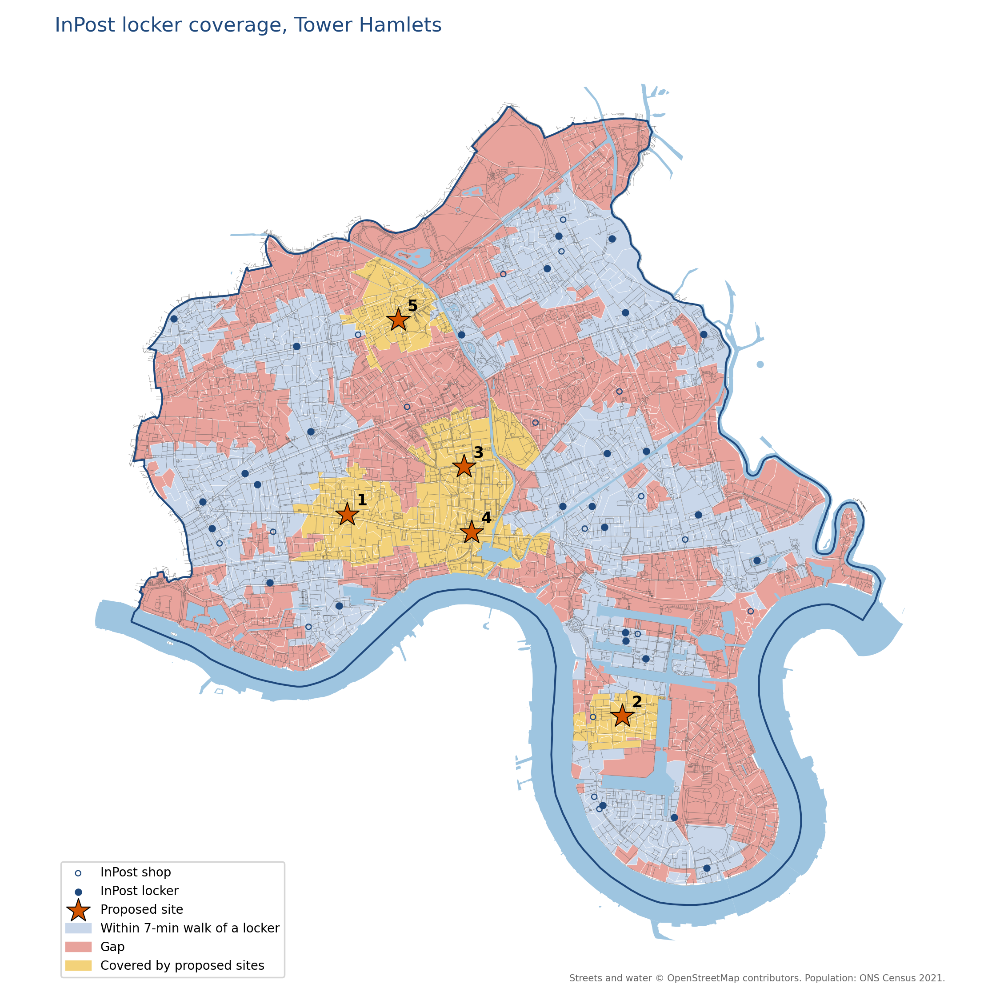

# InPost locker coverage for Tower Hamlets

I live in Limehouse, and my nearest InPost locker is about a 20-minute walk away. So I measured how many Tower Hamlets residents live within a 7-minute walk of a locker, and where five new lockers would help most.

> Independent analysis using public data. Not affiliated with InPost.



## Findings

- **40.6%** of residents are within a 7-minute walk of a locker (**57.4%** including InPost shops).
- **Five new lockers** would reach **52,000 more residents**, matching today's lockers-plus-shops coverage, but 24/7.
- **OpenStreetMap had only 24% of InPost's real lockers**, so I rebuilt the dataset by hand from InPost's locker finder.

## Method

Census 2021 population for 913 Output Areas, walking distances along the OpenStreetMap street network (7 min ≈ 560 m), and a greedy search over 359 candidate sites (shops, supermarkets, fuel and rail stations).

**Limitations:** lockers are placed by postcode, residents stand in for parcel demand, and candidate sites weren't surveyed.

## Run it

```bash
pip install -r requirements.txt
python tower_hamlets_lockers.py
```

Add the Census 2021 TS001 Output Area file (Nomis) and OA 2021 boundaries (ONS) to `data/` first.

Built with Python, GeoPandas, OSMnx and NetworkX · Data © OpenStreetMap contributors (ODbL), ONS (OGL v3)
